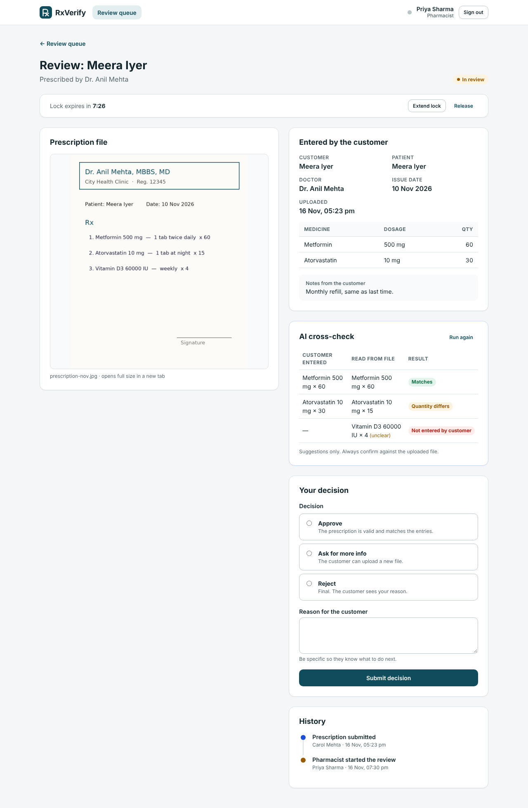
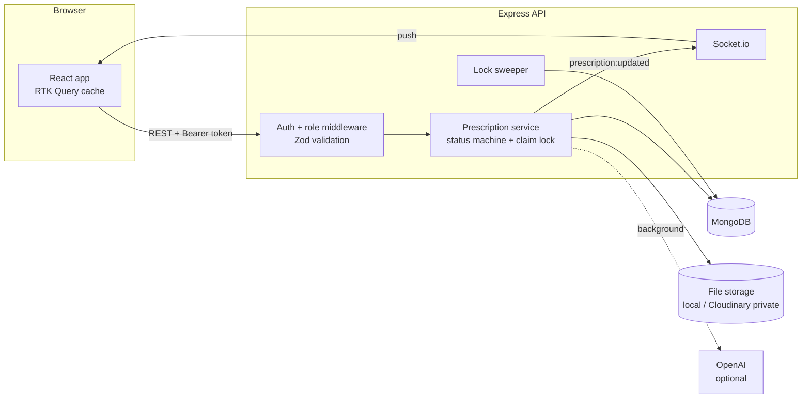
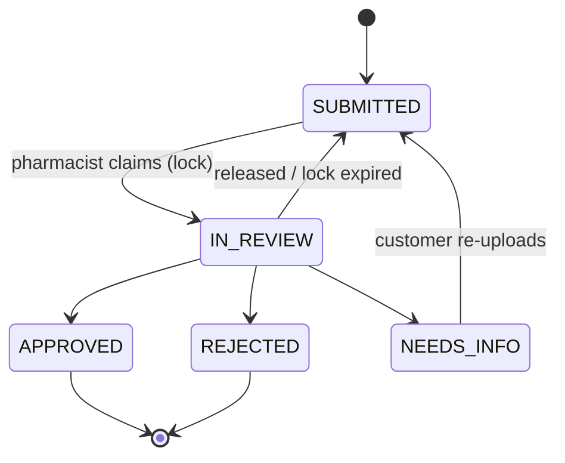
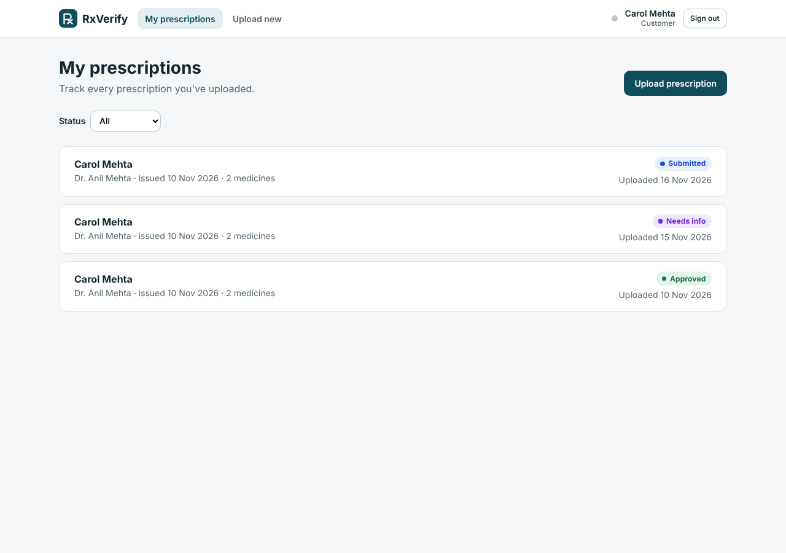
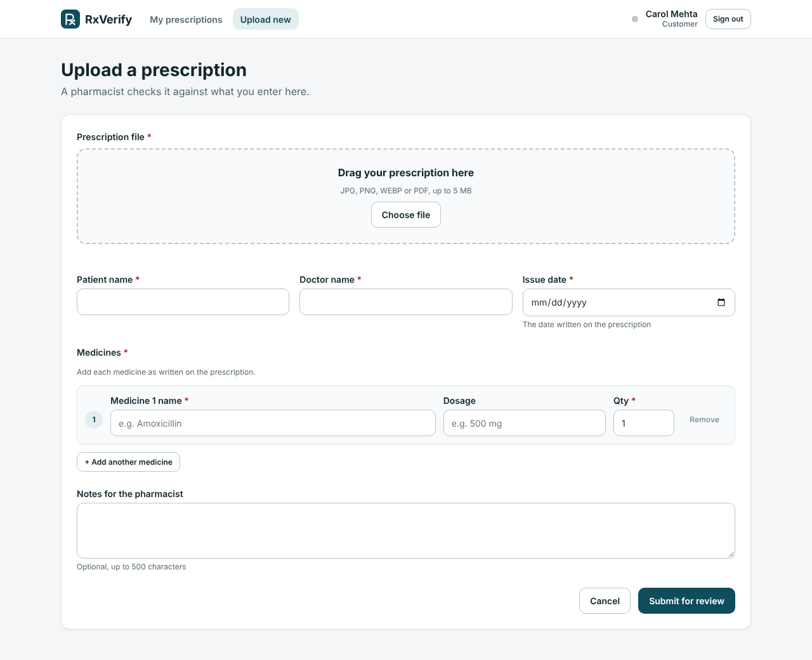
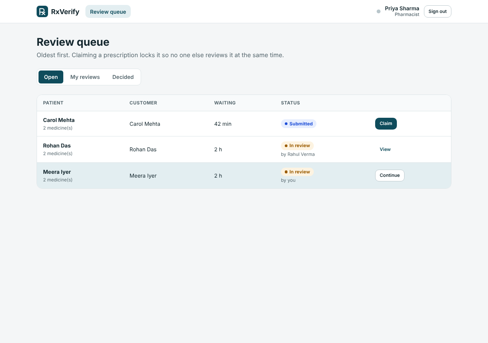
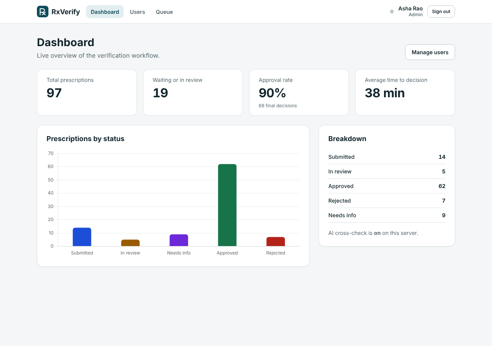

# RxVerify

Prescription upload and pharmacist verification, built with the MERN stack.

Customers upload a photo or PDF of a prescription. A pharmacist **claims** it (which locks it so nobody else reviews it at the same time), checks it, and approves it, rejects it, or asks for more information. Every step is recorded in an audit trail and pushed to everyone involved in real time.



## Features

**Customer**
- Register and sign in (JWT access token + httpOnly refresh cookie)
- Upload a prescription (JPG, PNG, WEBP or PDF) with patient, doctor, issue date and a list of medicines
- Track status live, see the full history, and re-upload when the pharmacist asks for more information

**Pharmacist**
- Review queue (oldest first) with Open / My reviews / Decided views
- Claim a prescription to lock it; the lock expires automatically if the pharmacist walks away
- Approve, reject or request more info, with a required reason the customer can read
- Optional AI cross-check: medicines read from the uploaded file are compared with what the customer entered

**Admin**
- Dashboard with counts by status, approval rate and average time to decision
- Create pharmacist accounts, deactivate or reactivate users (deactivation signs them out everywhere)

## Tech stack

| Layer | Choice |
| --- | --- |
| Frontend | React 19, Vite, React Router v8 (data mode, route middleware), Redux Toolkit + RTK Query, React Hook Form + Zod, Chart.js, Socket.io client |
| Styling | Plain CSS with design tokens; one stylesheet per component |
| Backend | Node.js 22, Express 5, Mongoose 9, Zod, Multer, Socket.io, JWT, bcrypt, Helmet, express-rate-limit |
| Database | MongoDB (Atlas in production) |
| File storage | Local disk in development, Cloudinary private assets in production |
| AI (optional) | OpenAI Responses API with Structured Outputs |
| Testing | Jest, Supertest, mongodb-memory-server, React Testing Library |
| CI/CD | GitHub Actions; Netlify (web) + Render (API) |

## Architecture



The server only pushes "prescription X changed" over the socket. The client marks the matching RTK Query cache entries as stale and refetches through the REST API, so all permission checks stay in one place.

### Status flow



## Key design decisions

- **One pharmacist per prescription.** Claiming is a single atomic `findOneAndUpdate` whose filter only matches a free prescription (or one whose lock expired). If two pharmacists click at the same moment, MongoDB applies the updates one at a time; the second no longer matches and gets `409 Conflict`. There is no "check, then write" gap. A test fires ten claims at once and expects exactly one winner.
- **Decisions use the same pattern.** Only the pharmacist holding a live lock can change the status; the rule lives in the update filter.
- **A server-side status machine** (`server/src/services/statusMachine.js`) lists every legal transition. Anything else returns 409, whatever the UI sends.
- **Expired locks.** Claim treats an expired lock as free (correctness). A background sweeper also puts expired reviews back to `SUBMITTED` (display + audit trail).
- **Private files.** Uploads are checked by size, declared type *and* their first bytes (magic numbers), stored outside any public folder (or as Cloudinary private assets), and streamed only through an authorized route with `Cache-Control: private, no-store`. Customers get a 404 (not 403) for other people's prescriptions, so ids can't be probed.
- **Auth.** Short-lived access token kept in memory (never localStorage); refresh token in an httpOnly, SameSite=Strict cookie, rotated on every refresh. Logout and deactivation bump a `tokenVersion`, which revokes all refresh tokens. RTK Query retries once after a silent refresh, and concurrent 401s share one refresh call.
- **Route middleware.** React Router v8 middleware restores the session and enforces roles before a page renders, so a protected page never flashes. Each page is a lazy-loaded chunk.
- **AI is advisory only.** Extraction runs in the background after upload, returns a strict JSON schema, and only writes the `aiExtraction` field. It never changes a status. Pharmacists see a side-by-side comparison; customers never see it. It is off unless `AI_EXTRACTION_ENABLED=true`.

## Screenshots

| | |
| --- | --- |
|  |  |
|  |  |

## Getting started

### Prerequisites
- Node.js 22.22 or newer (`.nvmrc` included)
- MongoDB running locally, or a free MongoDB Atlas cluster

### 1. API

```bash
cd server
cp .env.example .env        # set MONGO_URI if you use Atlas
npm install
npm run seed                # demo accounts, password: Password123
npm run dev                 # http://localhost:5000
```

Demo accounts: `admin@rxverify.dev`, `priya@rxverify.dev`, `rahul@rxverify.dev` (pharmacists), `carol@rxverify.dev` (customer).

### 2. Web app

```bash
cd client
npm install
npm run dev                 # http://localhost:5173 (proxies /api and /socket.io to :5000)
```

Tip: open two browsers (or one private window), sign in as Priya and Rahul, and both click **Claim** on the same prescription. Only one gets it.

## Environment variables (server)

| Variable | Default | Purpose |
| --- | --- | --- |
| `MONGO_URI` | `mongodb://127.0.0.1:27017/rxverify` | Database connection |
| `TRUST_PROXY` | `1` | Proxies in front of the API; use `2` on Render behind the Netlify proxy |
| `CLIENT_ORIGIN` | `http://localhost:5173` | Allowed origins for CORS and Socket.io (comma-separated) |
| `JWT_ACCESS_SECRET`, `JWT_REFRESH_SECRET` | dev values | Required in production |
| `ACCESS_TOKEN_TTL` / `REFRESH_TOKEN_DAYS` | `15m` / `7` | Token lifetimes |
| `COOKIE_SECURE` | `true` in production | Send the refresh cookie over HTTPS only |
| `LOCK_MINUTES` | `10` | How long a claim lasts |
| `LOCK_SWEEP_SECONDS` | `60` | How often expired locks are released |
| `MAX_UPLOAD_MB` | `5` | Upload size limit |
| `STORAGE_DRIVER` | `local` | `local` or `cloudinary` |
| `CLOUDINARY_*` | | Needed when `STORAGE_DRIVER=cloudinary` |
| `AI_EXTRACTION_ENABLED` | `false` | Turn the AI cross-check on |
| `OPENAI_API_KEY`, `OPENAI_MODEL` | | Needed when AI is on; any vision-capable model |

Client: `VITE_API_URL` (empty = same origin) and `VITE_SOCKET_URL` (your API URL in production).

## Testing

```bash
cd server && npm test        # unit + integration (in-memory MongoDB, downloaded on first run)
cd client && npm test        # React Testing Library
```

Server tests cover auth and token revocation, role checks, upload validation, every status transition, concurrent claims (2 and 10 at once), lock expiry and takeover, the sweeper, re-upload rules, audit visibility, admin actions, and AI extraction with a fake OpenAI client. Client tests cover route guards, forms, the upload component, the queue and the decision flow against a mocked API.

## Deployment

1. **MongoDB Atlas:** create a free cluster and copy the connection string.
2. **Render (API):** new Web Service from the `server` folder. Build `npm ci`, start `npm start`. Set `NODE_ENV=production`, `NODE_VERSION=22.22.0`, `TRUST_PROXY=2`, `MONGO_URI`, both JWT secrets, `CLIENT_ORIGIN=https://<your-site>.netlify.app`, `STORAGE_DRIVER=cloudinary` and the Cloudinary keys (Render's disk is temporary). Create the demo accounts by running `npm run seed` once on your machine with `MONGO_URI` set to the Atlas connection string.
3. **Netlify (web):** base directory `client`, build `npm run build`, publish `client/dist`. Set `VITE_SOCKET_URL=https://<your-api>.onrender.com`. Edit `client/public/_redirects` so `/api/*` points at your Render URL. This proxy keeps the API on the same origin as the site, so the SameSite=Strict refresh cookie works.

## API reference

| Method | Route | Role |
| --- | --- | --- |
| POST | `/api/auth/register`, `/login`, `/refresh`, `/logout` | public |
| GET | `/api/auth/me` | any signed-in |
| GET | `/api/config` | public |
| POST | `/api/prescriptions` (multipart) | customer |
| GET | `/api/prescriptions/mine` | customer |
| PUT | `/api/prescriptions/:id/file` (multipart) | customer, only in `NEEDS_INFO` |
| GET | `/api/prescriptions/queue?view=open\|mine\|decided\|all` | pharmacist, admin |
| POST | `/api/prescriptions/:id/claim`, `/release`, `/extract` | pharmacist |
| PATCH | `/api/prescriptions/:id/status` | pharmacist holding the lock |
| GET | `/api/prescriptions/:id`, `/:id/file`, `/:id/audit` | owner, pharmacist, admin |
| GET | `/api/admin/stats`, `/api/admin/users` | admin |
| POST | `/api/admin/pharmacists` | admin |
| PATCH | `/api/admin/users/:id` | admin |

## Project structure

```
rxverify/
├── client/                    React app
│   └── src/
│       ├── app/               store, RTK Query base API (silent refresh), toasts
│       ├── routes/            route objects + middleware guards
│       ├── features/          auth, prescriptions, queue (review), admin
│       ├── components/        FileUpload, FilePreview, Timeline, StatusBadge, ...
│       ├── hooks/             useRealtime (Socket.io), useAuthorizedFile
│       └── styles/            tokens.css, global.css
├── server/                    Express API
│   ├── src/
│   │   ├── services/          prescriptionService, statusMachine, storage/, ai/
│   │   ├── middleware/        auth, validate, upload, errorHandler
│   │   ├── models/            User, Prescription, AuditLog
│   │   ├── routes/ controllers/ validation/ socket/
│   │   └── server.js          HTTP + Socket.io + lock sweeper
│   ├── scripts/seed.js
│   └── tests/                 unit/ and integration/
└── .github/workflows/ci.yml
```

## License

MIT
